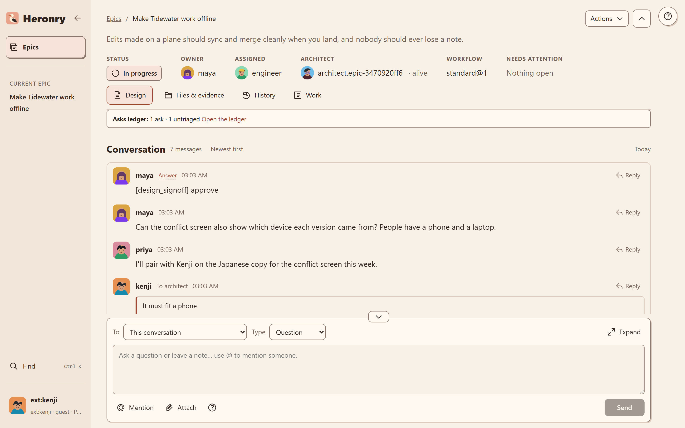
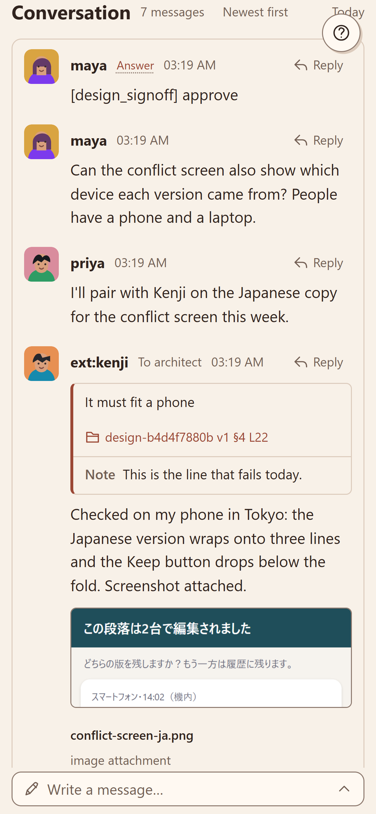

# Anywhere

## Teammates and guests

People join your board from their own computer with an invite. A **guest** sees only the epics they are
added to. Their handle carries an `ext:` mark wherever they post, so people and seats always know a
message comes from a guest.

Kenji is a guest on the Tidewater epic. Kenji sees that one epic and posts to its thread like anyone else:

To invite someone, see [Remote access and teammates](../setup/remote-access.md#invite-a-teammate).

## On a phone

The board works on a phone over your tailnet: read the thread, answer a question and look at
attachments.

<figure markdown>
{ width="360" }
</figure>
