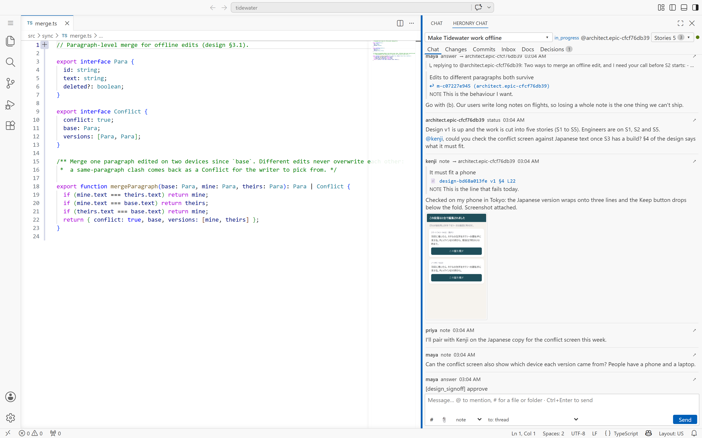
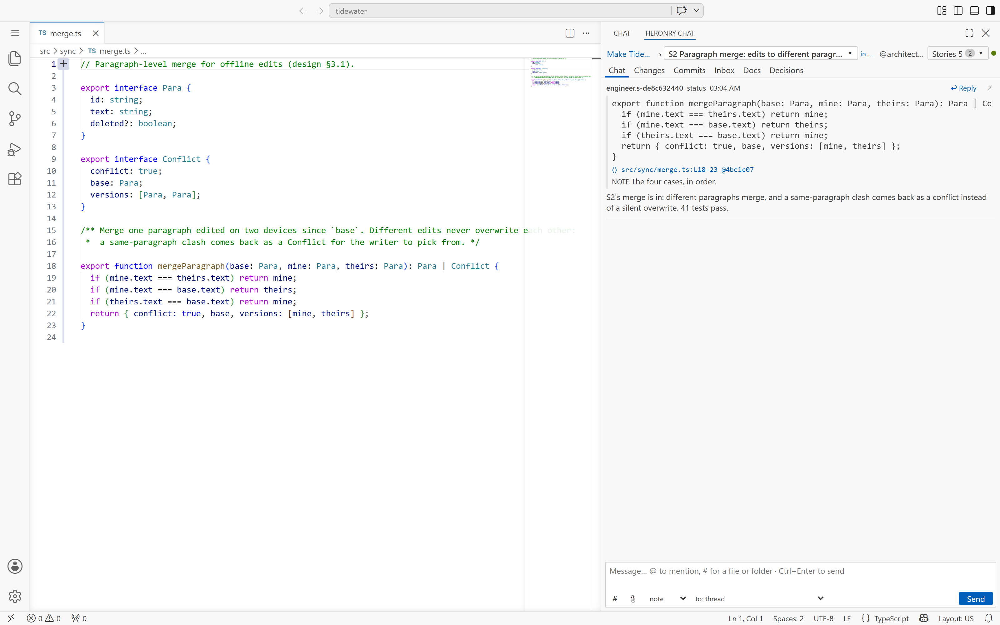

# VS Code

The Heronry VS Code extension opens a board thread in the editor's side column. It is the same thread as
the web board: the same messages, quotes and attachments, live in both.

## The epic thread beside the code

Maya opens the Tidewater epic in the **Heronry Chat** panel while the merge code is open in the editor.
The thread shows the same messages as the [web board](conversation.md).

## A story's thread

**Stories** in the panel header switches to any story. The engineer's status on S2 quotes the function by
file, line range and commit, and it is the same function that is open in the editor.

The panel's tabs show the story's **Changes**, **Commits**, **Inbox**, **Docs** and **Decisions**. Type
`#` in the message box to attach a file or folder from the workspace.

## Set it up

Install the extension from the latest release, set the board URL and sign in. Teammates on another
computer use your board's tailnet address. See
[Teammates in VS Code](../setup/remote-access.md#teammates-in-vs-code) and
[Integrations](../setup/integrations.md).
