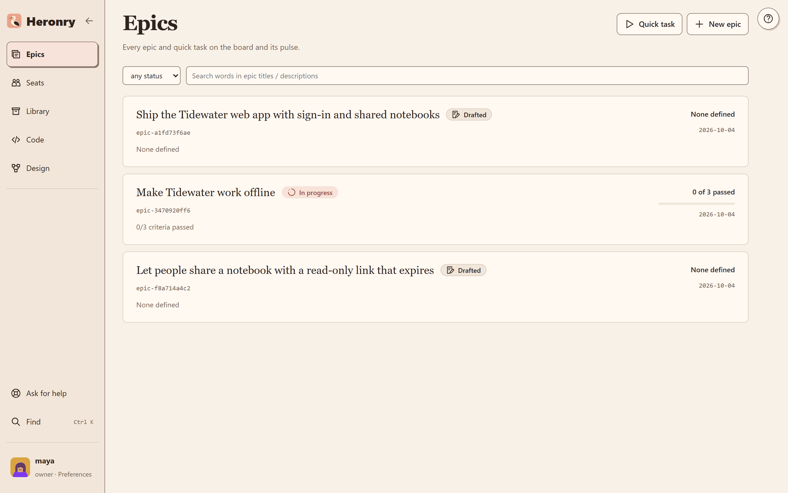
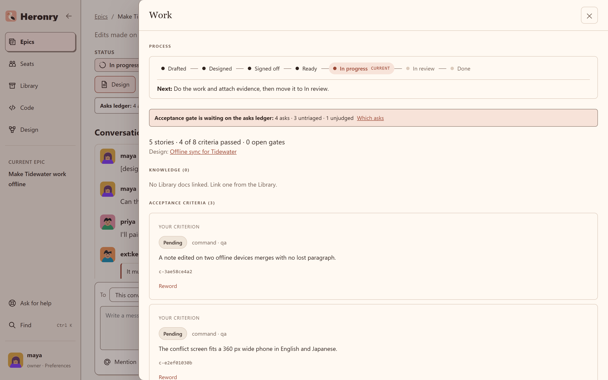
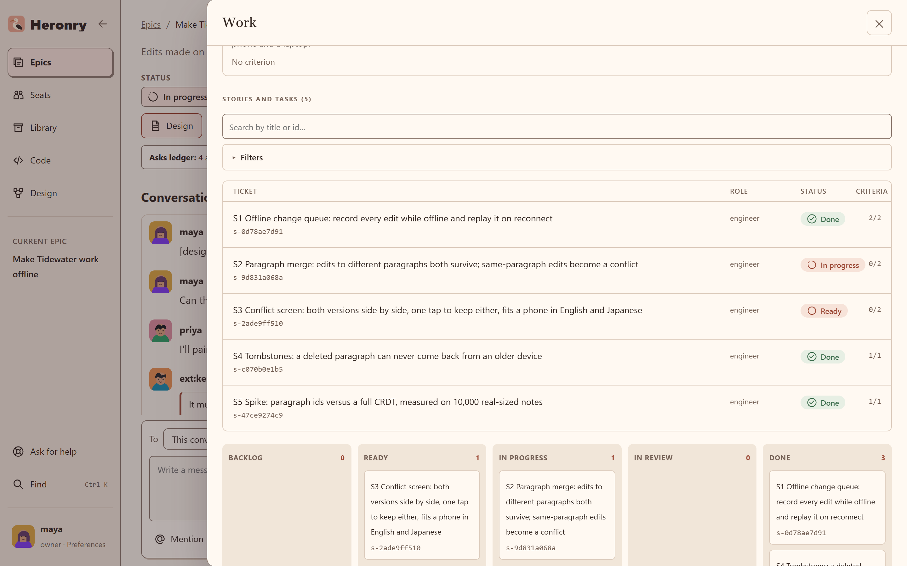
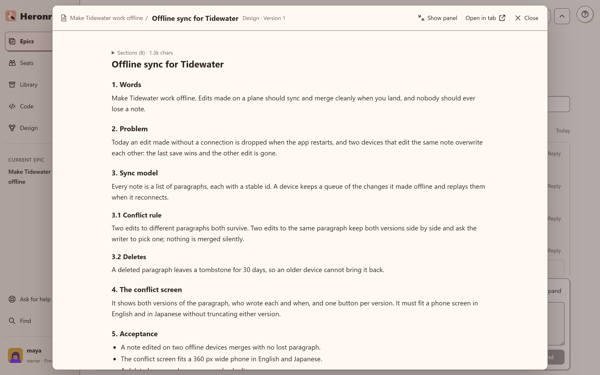
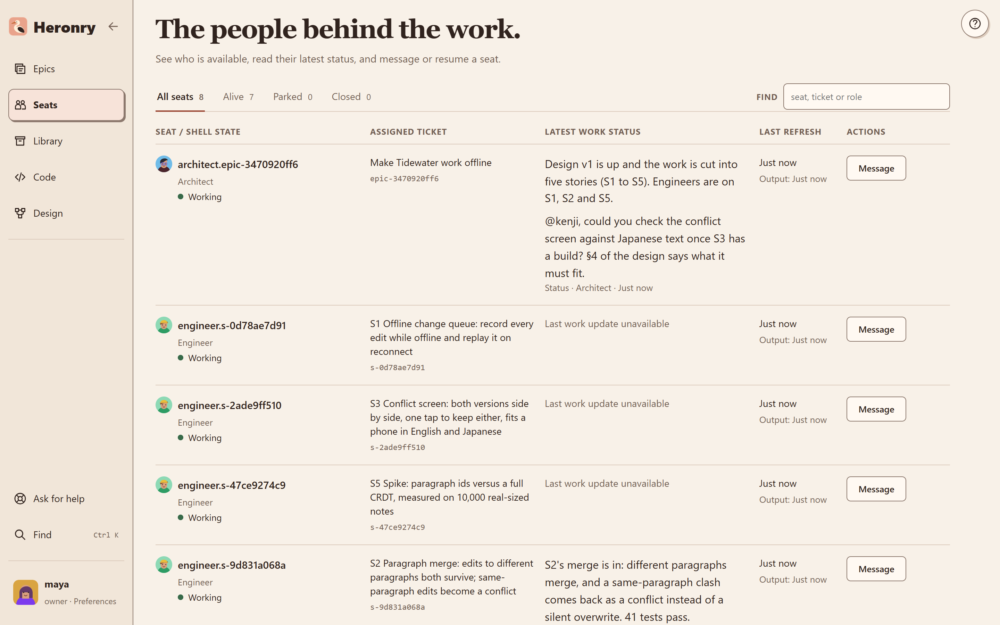

# Work and design

## The epics list

**Epics** lists every epic you can see, with its status and owner.

## The Work drawer

**Work** on an epic opens the drawer that shows where everything stands: the epic's acceptance criteria,
then every story with its status, its seat and its criteria.

## Mark as requirement

Select words in any message and press **Mark as requirement** on the quote card. No message is sent; the
board records the quoted words as a requirement of the epic. The architect links each one to a criterion or
to a section of the design, changing the design first when the words add something. The epic cannot finish
while a requirement is still open.

## The design beside the thread

**Design** opens the epic's design document over the thread. Its sections are numbered, so a quote can
point at an exact line, and every version is kept.

## Seats

**Seats** lists every seat: its role, the ticket it is working, its latest status and when it last
reported. Message a seat from here. **Close** ends a live seat's shell and records it as closed by you,
not as a crash; it sits beside **Resume** on the epic page too.

Read [Concepts](../docs/concepts.md) for the roles, statuses, gates and criteria behind these screens.
